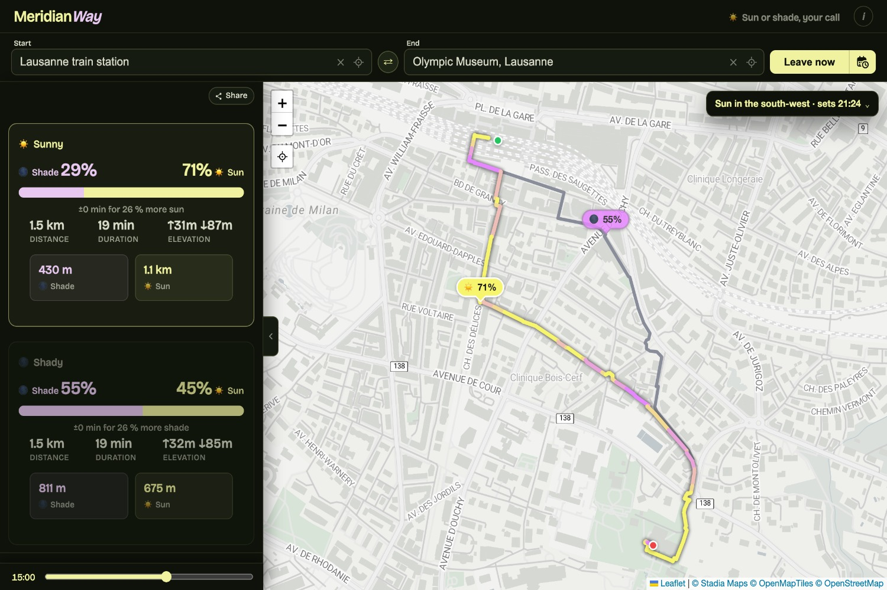

[MeridianWay][app] is a web app that finds two walking routes between two 
addresses for a chosen date and time: one with as much sun as possible, and one 
with as much shade as possible. A time slider shows how both routes change from 
sunrise to sunset.

Since around 2020, I’ve wanted a Google Maps-style option to choose between a 
route in the sun and one in the shade, alongside “fastest” and “shortest”. On my 
third attempt last July, I finally got the whole thing working.[^transp]

For each segment, the app estimates when the walker will reach it, calculates 
the sun's position at that moment, and checks whether nearby buildings or trees 
block the sun. During a 45-minute walk, the sun's azimuth changes by roughly 
11°, which can be enough to move the shaded side of a street.

[][app]

In Switzerland, the app uses building footprints and heights from 
[swissBUILDINGS3D 3.0][sb] (beta), a dataset from 
[swisstopo][swisstopo][^swisstopo]. I converted the dataset for the whole 
country and serve it from Cloudflare R2 through a small bounding-box service. 
On one test route in Lausanne, 26% of buildings had a mapped height in 
OpenStreetMap[^osm], compared with 100% in swissBUILDINGS3D 3.0. Outside 
Switzerland, the app uses OSM building heights where they are available in the 
vector basemap tiles, and default values for the rest. Trees and forests also 
come from OSM, with seasonal leaf cover.

Routes are computed using [OpenRouteService](https://openrouteservice.org), 
developed by the [HeiGIT][heigit], the Heidelberg Institute for Geoinformation 
Technology. The basemap comes from Stadia Maps, OpenMapTiles and OpenStreetMap. 
Terrain shadows are not modelled and roofs are treated as flat, so the results 
are estimates, not a guarantee that every part of a route will be shaded.

[MeridianWay][app] is a free, non-commercial side project with no account and no 
ads. It is available in French, German, Italian and English, with an initial 
version in Romansh. The [code](https://github.com/paultursuru/meridian) is 
open-source under the MIT licence.

[app]: https://meridian-way.ch/en/
[swisstopo]: https://www.swisstopo.admin.ch
[heigit]: https://heigit.org/
[sb]: https://www.swisstopo.admin.ch/en/landscape-model-swissbuildings3d-3-0-beta

[^transp]: Transparency note: I built and maintain MeridianWay as a non-commercial side project. I have no affiliation with swisstopo or any of the other data providers mentioned.
[^swisstopo]: The Federal Office of Topography of Switzerland.
[^osm]: [OpenStreetMap or OSM](https://www.openstreetmap.org/) is a collaborative, open-licensed map of the world.
