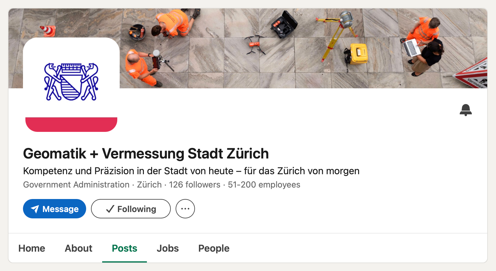

I _think_[^think] since three weeks, Geomatik + Vermessung of the city of Zurich 
has a LinkedIn presence: 

[][zuerich]

This is a welcome addition to cantonal geoinformation offices that have a 
similar presence, [KGK-CGC][kgk] at the inter-cantonal level and 
[swisstopo][swisstopo] at the federal level:

- Canton of Basel-Stadt: [Geoinformation Kanton Basel-Stadt][bs]
- Canton of Geneva: [Système d'information du territoire à Genève (SITG)][ge]
- Canton of Thurgau: [Amt für Geoinformation Kanton Thurgau][tg] 
- Canton of Zug: [Amt für Grundbuch und Geoinformation Kanton Zug][zg]
- City of Zurich: [Geomatik + Vermessung Stadt Zürich][zuerich]

Always nice to see additions to the geospatial online ecosystem (and the broader 
"digital" and "data" ecosystem), as any exchange among professionals in our 
industry is valuable. Let's build 
[smart networks][networks].

[^think]: [This](https://www.linkedin.com/posts/geomatik-vermessung-stadt-z%C3%BCrich-linkedin-share-7515750252675489792-eOdF/) 
_might_ be an announcement post? Albeit the wording is not clear. The account 
has only a bit more than 100 followers, for now. And the 
[earliest post](https://www.linkedin.com/company/geoz-stzh/posts/) I can access 
is three weeks old. 

[kgk]: https://www.linkedin.com/company/kgk-cgc/
[swisstopo]: https://www.linkedin.com/company/swisstopo/
[bs]: https://www.linkedin.com/company/geoinformation-kanton-basel-stadt/posts/
[ge]: https://www.linkedin.com/showcase/sitg-geneve/
[tg]: https://www.linkedin.com/company/amt-für-geoinformation-kanton-thurgau
[zg]: https://www.linkedin.com/company/amt-für-grundbuch-und-geoinformation
[zuerich]: https://www.linkedin.com/company/geoz-stzh/
[networks]: https://blogs.cornell.edu/info2040/2015/09/10/a-diverse-twitter-network-can-generate-better-ideas/