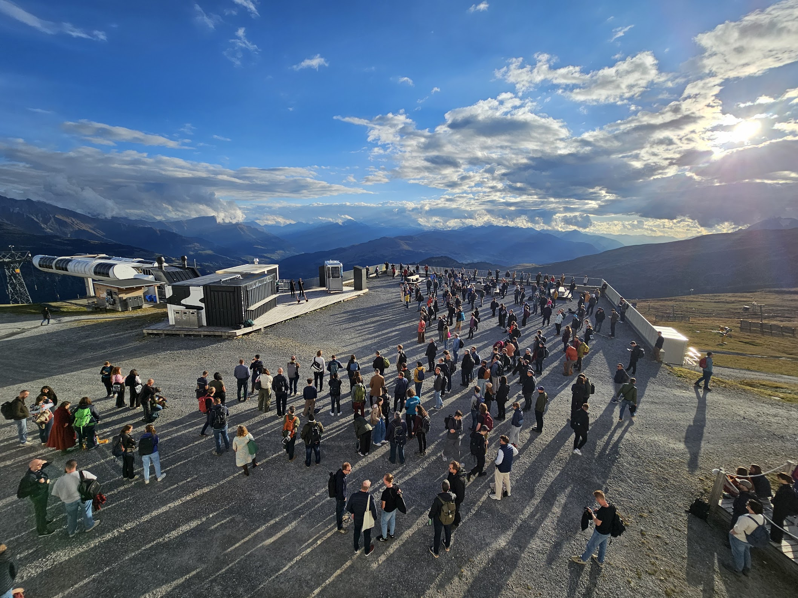

In the beginning of October, 400+ people met for the 2026 QGIS User Conference 
in Laax[^transp], more precisely on the Crap Sogn Gion^["Mount St. John" in Romansh] 
on around 2,000 metres altitude. You can read [a short summary][summary] 
by Tim Sutton on the conference blog and [a longer report][report] by Marco 
Bernasocchi (including a [collection of pictures][pics]) on LinkedIn.

I witnessed, and missed out on, some very interesting talks during the conference. 
So I'm glad that conference materials continue to be uploaded. You can find 
them [in the entries of the individual talks and workshops in the conference 
program][prog]. In my sample, 8 out of 10 contributors have uploaded their 
material by now. 

The conference team also filmed the presentations. According to the conference's 
Signal group, these videos should appear on YouTube soon ("in November"), I 
imagine under the official QGIS account at 
[youtube.com/@qgis](https://www.youtube.com/@qgis) – so good to have an eye on 
that.

[^transp]: Transparency note: My employer and this blog have been sponsors of 
the conference.

[summary]: https://blog.qgis.org/2026/10/13/qgis-user-conference-2026-brings-open-source-to-new-heights-in-the-swiss-alps/
[report]: https://www.linkedin.com/pulse/what-420-people-swiss-mountain-taught-me-digital-marco-bernasocchi-wla8e/
[pics]: https://photos.google.com/share/AF1QipMfInvu8ihCBR74wy55BVuWHV6ptTmnHFVU70ua5Z7kZgnch4WybORPS8FfG7ZsNQ?pli=1&key=Zjk1Ukp2ZVk4Y1FGTGNSUXN5WWl1N2hJOTFHT1Jn
[prog]: https://talks.osgeo.org/qgis-uc2026/schedule/