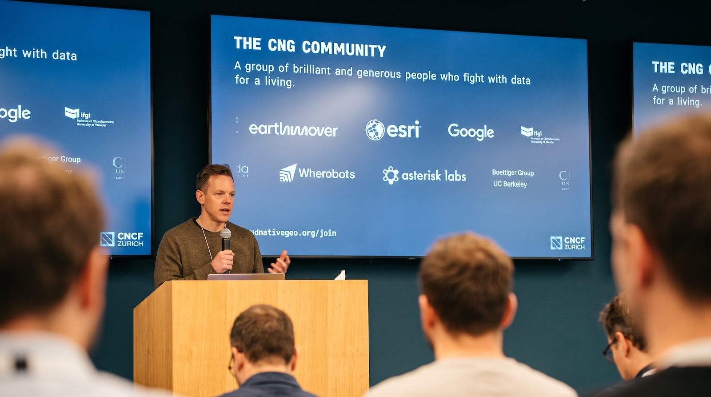

On 29 October, around 80 people filled the Zurich office of Meta for the
[cloud-native geo community gathering "CNG
Zürich"](https://cloudnativegeo.org/events/cng-zurich/)[^cng], [announced here
in
September](https://spatialists.ch/posts/2026/09/12-cloud-native-in-switzerland/).
The sentence heard most often: _"files in a bucket"_. A close second: _"we all
only work with files"_.

## From files to infrastructure

The recipe is simple: put data into object storage, in formats that can be read
in parts, and let others build on top. [Oliver
Wipfli](https://www.linkedin.com/in/oliver-wipfli-562258210/) showed how far
this carries with [Mapterhorn](https://mapterhorn.com), which aggregates open
terrain and aerial imagery from government platforms (swisstopo's swissALTI3D
among them) and ships it as PMTiles[^pmtiles]. Getting hold of the source data
in bulk was the painful part, a point for us data providers to take home. In
my talk[^transp], "From Tiles to Trust"
([slides](https://docs.google.com/presentation/d/1Mt13hfxKQiNV72abZRHV5hxneyqpA8ie/edit)),
I described that provider side: two years of serverless pipelines that publish
Sentinel-2 and aerial imagery as COGs[^cogs] in rapid mapping to a national
[STAC catalogue](https://data.geo.admin.ch/browser/index.html)[^stac] within
hours of acquisition.

[Nissim Lebovits](https://nl.linkedin.com/in/nlebovits) took the idea a step
further with
[Portolan](https://spatialists.ch/posts/2026/09/13-the-road-to-portolan/index.html),
an open specification and toolkit for running a spatial data infrastructure as
files in a bucket. It is only metadata, the bytes never leave the bucket, and
the bucket can be anywhere. Portolan also helps non-experts get their data into
STAC, and agents featured prominently (there is a skill for that). And for
GeoParquet to PMTiles the new and fastest kid on the block is:
[tylertoo](https://github.com/geoparquet-io/tylertoo). One challenge was named
plainly: secure your bucket. For a taste of how government data could look this
way, see this [proof of concept for Dutch
geodata](https://source.coop/cholmes/portolan-nl) (not affiliated with the Dutch
authorities).

Industry is already moving: [Jan
Winkler](https://www.linkedin.com/in/janmwinkler/) explained how [Swiss
Re](https://www.swissre.com) went from a lengthy desktop GIS update cycle for
geocoding in catastrophe modelling to automated cloud-native pipelines. In a
corporate environment, he noted, “_you don't look for the best solution but for
the best available one_”, and cloud-native formats brought transparency and
speed.

## Scale, embeddings and agents

The formats keep up with the ambition. [Federico
Oldani](https://it.linkedin.com/in/federicoldani) presented
[Terrazarr](https://pypi.org/project/terrazarr/), an open-source library for
lazy, resumable GeoZarr[^geozarr] pyramids, used to build the global 10 m raster
behind the [WSF Tracker](https://source.coop/mindearth/wsf) in about three
hours.

[Gjore Milevski](https://developmentseed.org/team/gjore-milevski/) ran SQL
against a [3D Zarr cube](https://gjoremilevski.com/posts/zarr-sql-views/) in the
browser, a really nice way to interact with Zarr, and [Pirmin
Kalberer](https://sourcepole.ch/en/about/sourcepole/pirmin/) showed that
cloud-optimised formats are more or less ready for the [Equal
Earth](https://equal-earth.com/equal-earth-projection.html) projection (see also
[Ben Joffe's map](https://benjoffe.com/map)) – equal-area when zoomed out and
Mercator when zoomed in.

Embeddings[^earth-embedding] (see also [this
primer](https://spatialists.ch/posts/2026/10/09-a-primer-on-embeddings/index.html))
were the other big thread. [Tom a.k.a. Hutch
Ingold](https://www.linkedin.com/in/tom-ingold/) of [Earth
Genome](https://www.earthgenome.org) showed [Earth
Index](https://app.earthindex.ai), which finds look-alikes in Sentinel-2
imagery. Its engine, Lancelot (a Rust service on LanceDB), searches about 7
billion embeddings in tens of milliseconds on a single node with plain object
storage, with reported cost savings of around a factor of six. The readout of
the [second Geo-Embeddings
Sprint](https://cloudnativegeo.org/blog/2026/07/announcing-geo-embedding-sprint-zurich)
(27 and 28 October at IBM Zürich) pointed to the next steps: standards,
evaluation and adoption.

[Michael DeWitt](https://github.com/michaelfdewitt) of Google asked whether
[Earth Engine](https://earthengine.google.com) is cloud-native, framed AI as an
abstraction layer that tames its complexity, and pointed to
[DatensEE](https://github.com/michaelfdewitt/datensee), a demo for parallel
exports into COGs in a bucket. His warning: it is risky to be on a tech island.

## Numbers over maps

All of this serves an end. [Stephan
Heuel](https://ch.linkedin.com/in/stephan-heuel) of
[Resilens](https://resilens.com) put it neatly: “_data and maps are not the
product, decision-grade numbers are_”
([slides](https://blog.heuel.org/2026/10/cng-zurich-2026-slides/)). Giorgio
Basile of [VIDA](https://vida.place) made a similar case with the DRE Atlas,
which turns building data into settlement-level energy access statistics for 58
countries, published as GeoParquet, PMTiles and STAC on Source Cooperative.

## Panel and takeaway

The panel agreed that we should understand user needs[^gov-uk] and invest in the
community instead of creating yet another format (of course, [xkcd
927](https://xkcd.com/927/) was mentioned). There was some controversy about the
word "cloud": publicly it tends to suggest a lack of sovereignty, whereas files
in a bucket can live in any bucket, with any provider, in any jurisdiction.
Worth more attention.

I liked the spirit, the crowd and the openness with which thoughts were shared.
My bet: Portolan is the next thing, and visualisation gets easier with it.
Thanks to [Jed Sundwall](https://www.linkedin.com/in/jedsundwall/) for bringing
the event to Zurich and for reaching out to the #SwissGIS community, and to Meta
for hosting. The [full programme](https://cloudnativegeo.org/events/cng-zurich/)
is online.

[^cng]: "CNG" stands for "cloud-native geospatial". "Cloud-native" means taking full
advantage of the cloud computing model; in the data world typically through
enabling partial downloads of file contents through so-called [HTTP range
requests](https://developer.mozilla.org/en-US/docs/Web/HTTP/Range_requests).
[^pmtiles]: [PMTiles](https://docs.protomaps.com/pmtiles/) is an open,
single-file archive format for map tile pyramids, designed to be read directly
from object storage via HTTP range requests, without a tile server.
[^transp]: Obvious transparency note: I gave a talk at the event and took part
in the panel discussion. I work at swisstopo, whose pipelines were the subject
of my talk.
[^cogs]: Cloud-optimized GeoTIFFs.
[^stac]: STAC stands for "SpatioTemporal Asset Catalog", a modern, open
specification for cataloging spatio-temporal data.
[^geozarr]: [GeoZarr](https://github.com/zarr-developers/geozarr-spec) is a
specification, developed within the OGC, that adds geospatial conventions such
as coordinate reference systems and multiscale pyramids to
[Zarr](https://zarr.dev/).
[^earth-embedding]: A geospatial embedding is a compact, high-dimensional vector
representation of a geospatial location, scene, or feature, learned so that
similar places or patterns end up close together in vector space. See this [primer](https://spatialists.ch/posts/2026/10/09-a-primer-on-embeddings/index.html).
[^gov-uk]: The [GOV UK Design
principles](https://www.gov.uk/guidance/government-design-principles) – almost
15 years old – are still the best start for user-centred data publishing pipelines.
