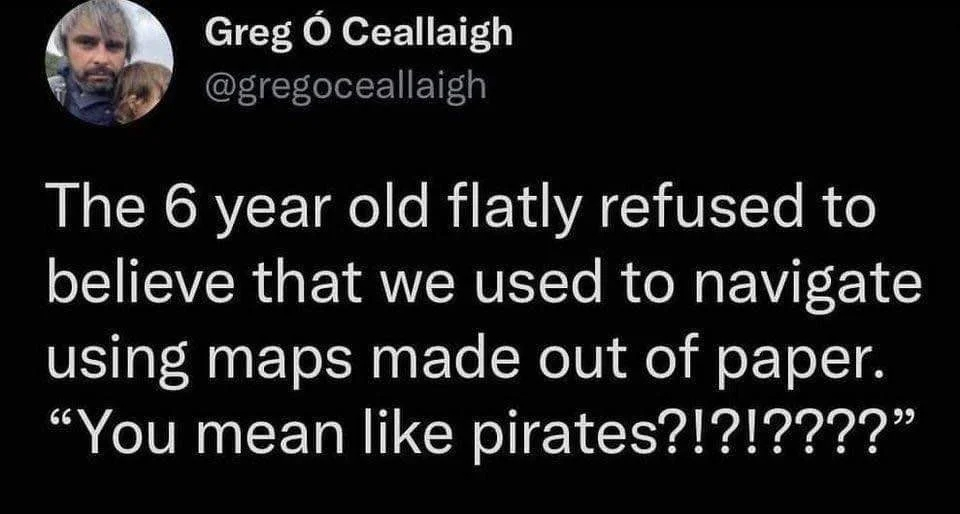

The Ordnance Survey (OS), Great Britain's NMA[^nma], celebrates the 225th 
anniversary of its first-ever map. From the [BBC][bbc]: "The first Ordnance
Survey map, which covered Kent and became a blueprint for modern mapping, is 
being celebrated 225 years after its publication. Published in 1801, the map 
was produced over fears of a Napoleonic invasion along the south coast."

The Guardian, too, has an [editorial][guardian] on this anniversary. And of 
course, so does the [OS itself][os]. While these are interesting – especially 
if you are into cartography – I have to agree with the feeling expressed by 
Jonathan Crowe in [The Map Room][maproom]:

> “One should not over-romanticise,” says the Guardian editorial marking the 
225th anniversary of the Ordnance Survey’s first publication, even while doing 
so. I’m always a bit nonplussed by celebrations of paper maps; I think I’d feel 
better if they weren’t quite so antiquarian (this one uses words like *charm*, 
*tactile* and *nostalgia*). It is possible to make a functional argument for 
paper maps.

This reminds me of an evergreen post (see also [here][also]):

[bbc]: https://www.bbc.com/news/articles/cmn06pzy8ek0o
[guardian]: https://www.theguardian.com/commentisfree/2026/nov/08/the-guardian-view-on-ordnance-survey-maps-still-a-superior-way-to-navigate-the-landscape
[os]: https://www.ordnancesurvey.co.uk/news/celebrating-225-years-since-the-1801-map-of-kent
[maproom]: https://www.maproomblog.com/2026/11/the-guardian-on-the-ordnance-survey-and-paper-maps/
[also]: https://www.reddit.com/r/NoStupidQuestions/comments/1vazi37/how_did_people_figure_out_directions_for_long/

[^nma]: National Mapping Agency.
