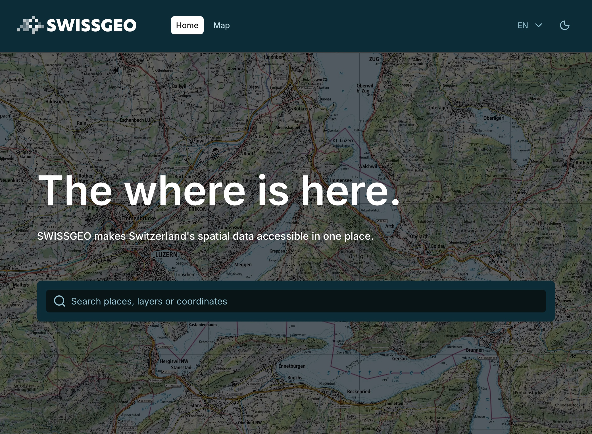
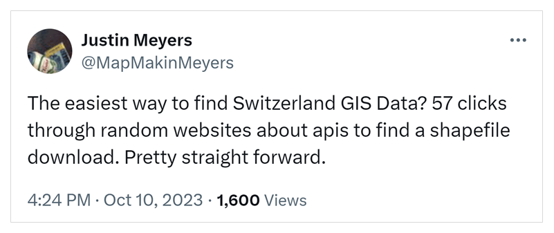

Long in the making, the new Swiss national geospatial portal, 
[SWISSGEO][swissgeo][^transp], has launched.[^officially]

SWISSGEO is a collaboration between the federal government and the Swiss cantons 
(states) and aims to make Switzerland's spatial data accessible in one place. I 
have written about [this idea and why it is valuable][blog-post] on my employer's 
blog, among other places (albeit in German), and SWISSGEO has been covered on 
[Spatialists][sp] before as well: see [here][1] and [here][2].

[][swissgeo]

SWISSGEO is set to gradually merge the following websites and services, which 
are components of the National Geospatial Data Infrastructure of Switzerland 
(NGDI[^ngdi] in German, INDG[^indg] in French):

- [geo.admin.ch](https://www.geo.admin.ch/) – the federal geoportal
- [geodienste.ch](https://geodienste.ch/) – the intercantonal portal for geodata and geodata services
- [geocat.ch](https://www.geocat.ch/) – the catalog of geographical data for Switzerland
- [geoinformation.ch](https://www.geoinformation.ch/) – information page on the Swiss Geoinformation Strategy[^sgs]
- [geostandards.ch](https://geostandards.ch/) – organization in the field of geostandards and INTERLIS[^interlis]

There is an [announcement in German][de-a] and [in French][fr-a]:

> We’re launching with this first version: not all features have been integrated 
yet – these will be added gradually – but the new national platform, SWISSGEO, 
is available to use right away! 💻
> 
> What’s already available? 🛠️
>
> ✅ Everything in one place: federal and cantonal data brought together for the first time.
>
> ✅ Modern map viewer: A new, intuitive and user-centred map viewer for visualisation.
>
> ✅ User-friendly layer information: A completely new design for the legend and key data information.
>
> ✅ Single information portal: Consolidated information on geodata, the Swiss Geoinformation Strategy, as well as geo-standards, basic geodata, geodata models and metadata.
> 
> What’s next? ⏳
>
> 🔹 Integration of the familiar and popular tools from the map viewer map.geo.admin.ch
>
> 🔹 Modern, standardised web services
>
> 🔹 New, innovative solutions

At the same time, the [SWISSGEO LinkedIn account][li] has been [launched][launch].[^officially]

Click through to explore the [first public version of SWISSGEO][swissgeo]. It 
will be interesting to see how the new portal is received (and whether it will make 
Justin's evergreen tweet obsolete).

[^transp]: Transparency note: Through my employer, I contributed to an early 
concept phase in 2023.
[^officially]: _Officially_ launched, that is; it had been online before.
[^ngdi]: Nationale Geodateninfrastruktur.
[^indg]: Infrastructure nationale de données géographiques.
[^sgs]: The [Swiss Geoinformation Strategy](https://www.geo.admin.ch/de/strategie-und-umsetzung), a national action strategy with annual action plans for the geoinformation sector in Switzerland.
[^interlis]: [INTERLIS](https://www.interlis.ch/en) is a Swiss standard for geodata modelling and data exchange.

[1]: https://spatialists.ch/posts/2025/06/13-swissgeo-the-swiss-geospatial-platform/
[2]: https://spatialists.ch/posts/2025/09/01-swissgeo-prototype-online/
[swissgeo]: https://www.swissgeo.ch/
[blog-post]: https://digital.ebp.ch/2024/10/20/schweizer-geoinformation-2024-connecting-the-dots-perpetual-beta/
[sp]: https://spatialists.ch
[fr-a]: https://www.linkedin.com/posts/swissgeo-gaezodonnaezes-gaezoinformation-ugcPost-7528432061074931712-2_eZ/
[de-a]: https://www.linkedin.com/posts/swissgeo-geodaten-geoinformation-ugcPost-7528429437877489664-WoDr/
[li]: https://www.linkedin.com/company/swissgeo/
[launch]: https://www.linkedin.com/posts/swissgeo-geodata-kartenviewer-share-7528408315685675008-kyoW/

