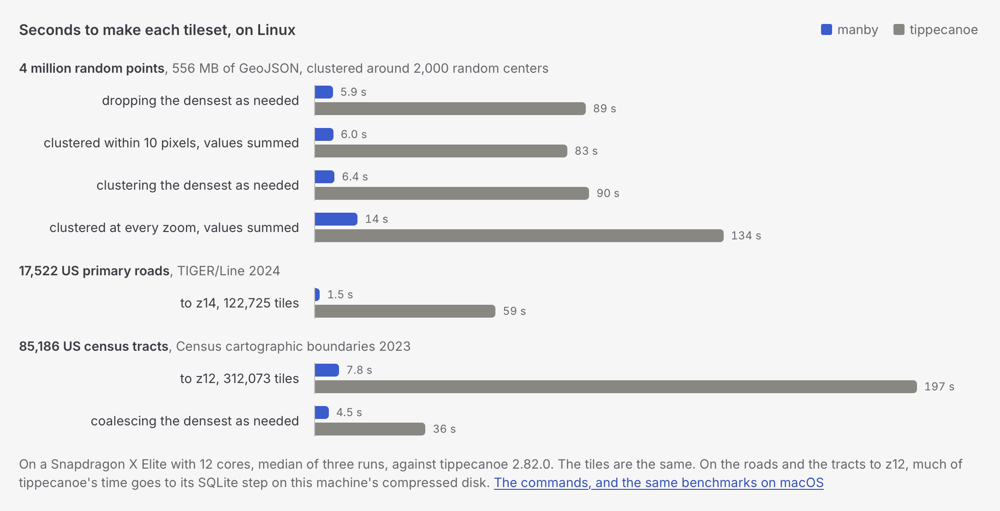

[manby][mb] is a new Rust-based alternative for producing vector tiles developed 
by [Birk Skyum][birk], co-founder of [MapLibre][ml]. It is a drop-in alternative 
to [tippecanoe][tc] – meaning that manby takes all of tippecanoe's options, so 
a `tippecanoe` command works with "`manby`" in its place (tested against all 188 
of tippecanoe’s expected test outputs, according to the [manby website][mb]). 

manby can produce vector tiles from "from GeoJSON, FlatGeobuf, CSV, Geobuf, 
GeoParquet, Arrow, GeoPackage or Shapefile features, GeoParquet in object 
storage, and from DuckDB queries and data frames in Python and R". There is 
both a Python package and an R library to use manby from those environments.

The website has [benchmarks against tippecanoe][bm] and [tylertoo][bm2] 
that show it eight to eighteen times faster. There is also a [comparison 
matrix][cm] including `tippecanoe-rs` (a line-by-line Rust rewrite of tippecanoe 
in the manby repository), `planetiler`, GDAL, `freestiler`, and `geojson-vt`.

manby is [open-source][repo] under the BSD-2-Clause license. This continues the 
"Rust-ification" of open-source geospatial tools.

[mb]: https://birkskyum.github.io/manby/
[birk]: https://www.linkedin.com/in/birkskyum/
[ml]: https://maplibre.org/
[tc]: https://github.com/felt/tippecanoe
[repo]: https://github.com/birkskyum/manby
[bm]: https://birkskyum.github.io/manby/reference/benchmarks/
[bm2]: https://birkskyum.github.io/manby/reference/benchmarks/#against-tylertoo
[cm]: https://birkskyum.github.io/manby/why/#compared-with-the-alternatives